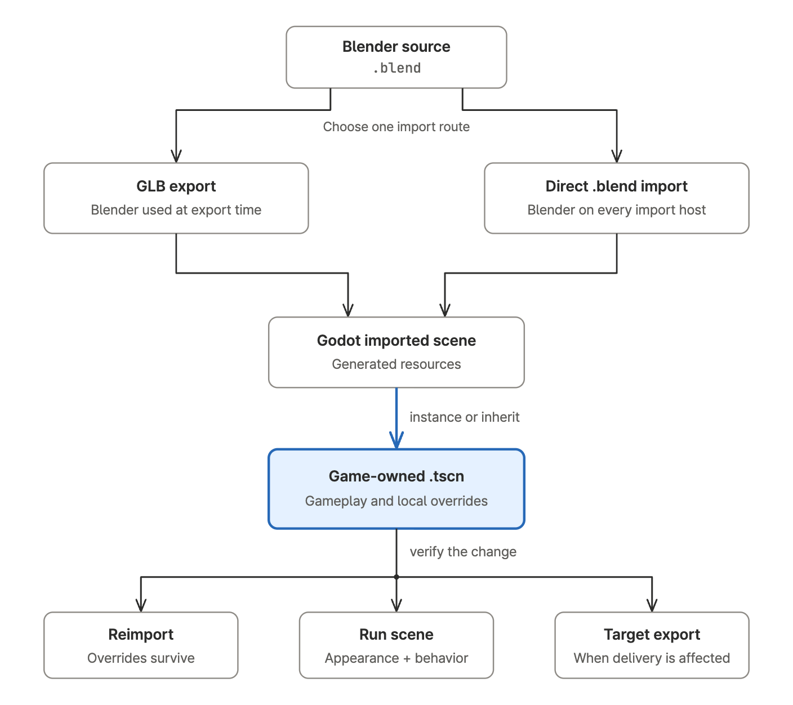

# godot-best-practice

A portable agent skill for building and debugging Godot projects. It checks the
project's engine version, preserves scene and resource ownership, and verifies
changes through imports, scene runs, visual checks, or exports as the task needs.

Supports GDScript, Godot C#, 2D, 3D, UI, shaders, asset pipelines, and version
migrations. The same skill works in Codex, Claude Code, and other agents that
support `SKILL.md`.

## Install

Install for the current project with Node.js 22.20 or newer:

```bash
npx skills add gigio1023/godot-best-practice --agent codex claude-code
```

Add `--global` to install across projects, or select only the agents you use.
The complete payload lives in [`skills/godot-best-practice/`](skills/godot-best-practice/).
For a development checkout or manual symlink, use the
[Codex](.codex/INSTALL.md) or [Claude Code](.claude/INSTALL.md) guide.

The commands and agent paths were checked against
[Skills CLI 1.7.4](https://github.com/vercel-labs/skills/tree/a80e4c9d12d607631249d4d7d059f835d4b2f13a)
on 2026-10-23. Installation does not install Godot, Blender, or an editor plugin.

## Use

Ask for the result you need and identify the project:

- “Fix this GDScript using the project's Godot version and run the relevant checks.”
- “Review this `.tscn` diff for resource, NodePath, and ownership risks without editing files.”
- “Bring this Blender asset into Godot and verify materials, animation, collision, and reimport behavior.”
- “Diagnose why this GLB works in the editor but fails in the exported game.”

The agent inspects the project, chooses the relevant reference, makes the change,
and reports what it actually verified. A script parse does not establish scene,
runtime, visual, or export correctness.

## Blender to Godot

<picture>
  <source media="(prefers-color-scheme: dark)" srcset="docs/figures/blender-godot-workflow.dark.png">
  
</picture>

Keep gameplay changes in a game-owned scene, then verify that they survive
asset reimport. Export GLB for a controlled
handoff, or import `.blend` directly when every import host has a compatible
Blender installation. Add gameplay through a scene that instances or inherits
the imported scene. See the [Blender pipeline](skills/godot-best-practice/references/blender-pipeline.md)
for transforms, materials, animation, collision, and validation.

## Optional live editor

A configured [Godot AI](https://github.com/hi-godot/godot-ai) integration can
inspect scenes, make editor-owned changes, run gameplay, and capture visual
evidence. The agent first matches the editor session to the intended project.
File editing and the Godot CLI remain available for code, imports, CI, and
exports. See [live editor control](skills/godot-best-practice/references/live-editor-control.md)
for capability checks and setup boundaries.

## Baseline and verification

The documentation baseline is **Godot 4.7.2 stable** and **Blender 5.2.3 LTS**,
checked on 2026-10-23. It is a source baseline, not a measured compatibility
guarantee. The skill uses the target project's versions and checks official
sources for version-sensitive behavior. Exact revisions are in
[source provenance](docs/source-provenance.md).

The [October 2026 engine checks](evals/validation-2026-10-23.md) cover a real
Godot 4.7.2 import, script parsing, and a bounded headless scene run. The
[Blender smoke fixture](evals/blender-smoke/README.md) provides reproducible
pipeline checks. These checks establish the behavior they exercise, not the
skill's effect on an agent's work.

The [July 2026 agent evaluation](evals/results.md) covered an earlier snapshot:
the Codex matrix completed and the Claude Code matrix was partial. It used no
real Godot executable. See the [evaluation protocol](evals/README.md) for a new
comparison of agent behavior.

## License

[MIT](LICENSE). Official Godot and Blender sources are linked, not vendored.
